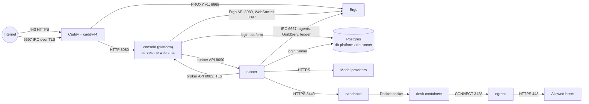

# Architecture

How a GuildNet install is built: its processes, networks, identities, data,
agents and desks. Paths are relative to the repository root. The web chat is
a separate repository, `guildnet-chat`.

## 1. Overview

A GuildNet install runs one network: one company's IRC network, its org chart, its agents and its console. The self-host stack (`deploy/selfhost/compose.yml`) runs the following processes on one machine.

**The console** (`cmd/platform`, package `platform`, launched by `app/platform`). Serves the home site on the base domain (first-run setup), the network's console on `<network>.<domain>`, the web chat files and its WebSocket relay to Ergo, and the broker API the runner calls for settings and secrets. It owns the `platform` database and holds the long-lived secrets: model keys, connector tokens, git credentials, the GitHub App key, the desk-token signing key and the internal CA.

**The runner** (`cmd/runner`, package `runner`, launched by `app/runner`). One per network. It opens one IRC connection per agent, one for GuildServ (the control-plane bot) and one for the ledger bot. It decides which agent wakes, runs the model loop, enforces budgets and approvals, and keeps Ergo in step with the org chart. It serves the runner API and the outside-agent API, both reached only through the console. It owns the `runner` database and the ledger files.

**Ergo** (`deploy/ergo`). The IRC server, built from source at its release with one patch (`authoritative-auth-script.patch`). Registration is off and SASL is required, so only accounts the console or runner creates can connect. Its HTTP API manages accounts; it accepts short-lived JWTs from the web chat. People's passwords are the console's: Ergo's auth-script (`guildnet-ircauth`, `deploy/ergo/ircauth`) asks the broker's `/irc/login`, with Ergo's API token, and the patch makes the answer final, unless the console says the account isn't its (an agent's: Ergo checks its own). The patch also stops people changing their password, adding a certificate or unregistering over IRC.

**Postgres** (`deploy/postgres`). Postgres 18 with databases `platform` and `runner`, each owned by its own login; `CONNECT` is revoked from `public`.

**Caddy** (`deploy/caddy`). The edge, built with caddy-l4. It terminates HTTPS for both hostnames (Let's Encrypt) and IRC TLS on 6697, and keeps no access logs.

**sandboxd** and **egress** (`cmd/sandboxd`, compose profile `desks`, optional). `sandboxd serve` drives desk containers through the Docker socket. `sandboxd proxy`, run as the `egress` service, is the desks' only route out.

**The web chat** (`guildnet-chat`, a Preact fork of gamja). Static files built into the console image and served at `/chat/app/`. It connects through `/chat/socket` and signs in with SASL `IRCV3BEARER`.

The cloud deployments run the same images with the same settings: `deploy/gke` puts Caddy, the console, Ergo and the runner in one pod, `deploy/aws-fargate` in one ECS task (both with a managed Postgres), and `deploy/desks-host` runs sandboxd and egress on a VM of their own. This document describes the Compose stack.

## 2. Processes and ports

All services listen on every interface of their container (`:port`), so a listener is reachable from every Docker network its service is on. Only Caddy publishes ports.

| Service | Binary / image | Listens on | Talks to | Persistent state |
|---|---|---|---|---|
| `caddy` | `caddy:2` + caddy-l4 v0.1.2 | 80, 443/tcp, 443/udp, 6697 (published); `edge`, fixed 172.30.0.2 | console :8080, :6699; Ergo :6668 | `caddy-data`, `caddy-config` (certificates, ACME state) |
| `platform` (console) | `/platform` on distroless static, uid 65532 | 8080 HTTP; 8082 broker (TLS 1.3); 6699 plain-IRC hint; `edge`, `private`, `data` | Postgres, Ergo API and WebSocket, runner API, sandboxd, SMTP, GitHub, model providers (key checks), connectors' OAuth servers, git hosts (credential checks) | Postgres `platform`; `broker-ca` (CA key and broker certificate); `broker-ca-shared` (CA certificate); `sandbox-tls` (sandboxd's certificate) |
| `ergo` | `ghcr.io/ergochat/ergo:stable` + GuildNet config, uid 65534 | 6667 plain IRC; 6668 PROXY-protocol IRC; 8097 WebSocket; 8089 HTTP API (bearer); `edge`, `private` | none | `ergo-data` (accounts, channels, history); `welcome` (MOTD, shared with the runner) |
| `runner` | `/app/runner` on distroless static, uid 65532 | 8090 runner API; `private`, `data` | Ergo :6667 and :8089, console broker :8082, Postgres, model providers, GitHub, git hosts (pushes), connectors' MCP servers, outside agents' webhooks, sandboxd | Postgres `runner`; `runner-data` (ledger files); `welcome` |
| `postgres` | `postgres:18-alpine` | 5432; `data` | none | `postgres-data` |
| `sandboxd` | `sandboxd serve` on `docker:28-cli` | 8443 HTTPS; `private` | Docker socket | per-desk Docker volumes `gn.<network>.<nick>.work` and `.home`, or with `GUILDNET_DESK_FILES`, `<files>/<network>/<nick>/work` and `home` (limited per network on XFS); reads `sandbox-tls` |
| `egress` | `sandboxd proxy`, uid 65534 | 3128; `desks` (fixed 172.31.255.2), `outbound` | allowed public hosts on 443; networks' git hosts on their ports | none |
| `desk` | `golang:1.27-bookworm` + Node, Python, git, ripgrep | image only, `scale: 0` | n/a | n/a |
| `files` | `tar` in the Postgres image, profile `tools`, `network_mode: none` | none | none | mounts `ergo-data`, `runner-data` for `backup.sh` and `restore.sh` |

Every image is `${GUILDNET_REGISTRY:-ghcr.io/guildnet-chat}/<name>:${GUILDNET_VERSION}`, where `<name>` is the `deploy/` folder it builds from (`egress` runs `sandboxd`'s image, `files` Postgres's). `docker compose pull` fetches a release's published images; `--build` builds the same names from source.

Every service drops all capabilities and sets `no-new-privileges` (`x-locked`). The console, Ergo, the runner and egress have read-only root filesystems. Caddy adds `NET_BIND_SERVICE`; Postgres adds the five its entrypoint needs. `sandboxd` sets no `user:` and mounts the Docker socket, so it is root-equivalent on the host.

## 3. Docker networks

| Network | Members | Properties | Purpose |
|---|---|---|---|
| `edge` | caddy, platform, ergo | 172.30.0.0/24; Caddy fixed at .2, others from .128/25 | Caddy reaches the console and Ergo. The console trusts `X-Forwarded-For` only from 172.30.0.2 (`GUILDNET_TRUSTED_PROXIES`). |
| `private` | platform, ergo, runner, sandboxd | default bridge, has a route out | Service-to-service traffic, and the runner's and console's route to the internet. |
| `data` | postgres, platform, runner | `internal: true` | Database access. No route out; Caddy is not on it. |
| `desks` (`guildnet-desks`) | egress, every desk container | `internal: true`, 172.31.255.0/24; egress fixed at .2, desks from .128/25 | Desks reach only egress. sandboxd is not on it; it drives desks through `docker exec`. |
| `outbound` | egress | default bridge | egress's route to the internet, shared with nothing else. |

From outside, only Caddy's 80, 443 and 6697 are reachable. Internal listeners are reachable from any container sharing a network: the broker (:8082) is on `edge`, but Caddy does not route to it and every call needs the network secret. Caddy routes:

- `{$GUILDNET_DOMAIN}` and `{$GUILDNET_NETWORK}.{$GUILDNET_DOMAIN}` to `platform:8080`.
- :6697 with TLS SNI `<network>.<domain>`: TLS ends at Caddy, then `proxy_protocol v1` to `ergo:6668`. Ergo accepts PROXY headers only from RFC 1918 ranges (`ERGO__SERVER__PROXY_ALLOWED_FROM`).
- :6697 without TLS: to `platform:6699`, which tells the client to use TLS (`platform/irchint.go`).

`desks-firewall.sh` adds iptables rules in `DOCKER-USER` and `INPUT` (with `br_netfilter`): traffic between addresses in 172.31.255.0/24 is dropped except TCP to 172.31.255.2:3128 and established replies, and desks get `REJECT` for new connections to the host. `install` adds a systemd unit that reapplies the rules whenever Docker starts.

## 4. Identity and authentication

**First-run setup** (`platform/firstrun.go`). With `GUILDNET_NETWORK` set, the home site serves setup until the network exists. At each start before setup completes, the console prints a new 12-character code (alphabet without 0, O, 1, I, L; about 59 bits) to its log and keeps only its SHA-256 hash in memory. A visitor gets 5 wrong codes per 15 minutes. The form takes a template, timezone, owner nick and password, and one model provider key (checked with the provider). The console stores the network record, registers the owner's account on Ergo (`/v1/ns/saregister`), waits for the runner, and hands the setting-up browser into the console with a one-time code. `platform reset-owner` (shell access only) prints a one-hour, one-use password reset link for the owner and turns their two-step sign-in off.

**Home site sign-in** (`platform/home.go`, `emailsignin.go`, `hometwostep.go`). The home site has separate people and sessions (email link or code, or Google, with its own two-step). A self-hosted network's owner is an IRC account and needs no home-site account.

**Console sign-in** (`platform/pages.go`, `twostep.go`, `passkeys.go`). The console checks the IRC account's password through Ergo's HTTP API (`POST /v1/check_auth`, bearer `GUILDNET_ERGO_API_TOKEN`); it does not use SASL. It then calls the runner's `GET /v1/org` as that account; the runner refuses anyone who is not a person in the org. Attempts are limited to 5 per 15 minutes per network and account. If two-step is on, a second step follows: a TOTP code (RFC 6238, SHA-1, 30 s, 6 digits, ±1 step, each step used once), one of ten recovery codes, or a WebAuthn passkey. With `GUILDNET_SECURE_COOKIES=on`, the owner and anyone with org-wide change abilities must set two-step up before anything else. Sessions are random 32-byte cookie tokens, stored by keyed hash, each with a CSRF token; cross-origin non-GET requests are refused. Ergo stores passwords as bcrypt (cost 10).

**Two-step and IRC** (`runner/twostep.go`). IRC clients sign in with the password alone. The runner asks the broker (`GET /two-step`) whether an account uses or must use two-step; for those accounts GuildServ accepts org changes only through the console (`POST /v1/guildserv`), and over IRC they can only read.

**Web chat** (`platform/chat.go`, `guildnet-chat/lib/bearer.js`). `POST /chat/token` returns an HS256 JWT signed with `GUILDNET_CHAT_KEY`: claims `account`, `aud` = network name, `iat`, `exp` one minute later. Ergo's `jwt-auth` validates `aud` and does not create accounts. The app authenticates with SASL `IRCV3BEARER` (type `jwt`). `/chat/socket` requires a session and a same-origin `Origin`, sets `X-Forwarded-For`, strips cookies, and closes when the session signs out.

**Agent and GuildServ IRC accounts** (`runner/accounts.go`). Each agent's password is base64url(HMAC-SHA256(`GUILDNET_ACCOUNT_SECRET`, lowercase nick)); no password list is stored. The runner registers accounts through Ergo's API and refuses to claim an existing account whose password does not match the derived one. GuildServ becomes an IRC operator with `OPER guildserv <GUILDNET_OPER_PASSWORD>`; Ergo's `start.sh` hashes that password at start (`server-admin` class, hidden).

**Console and runner** (`platform/clients.go`, `runner/api.go`, `platform/github.go`). Both directions use `GUILDNET_API_TOKEN`, compared in constant time. Console to runner: plain HTTP on `private`, `Authorization: Bearer <token>` and `GuildNet-Actor: <account>`; the runner applies that person's permissions, the same as GuildServ would. Runner to broker: `Authorization: Bearer <token>` and `GuildNet-Network: <name>`; a suspended or deleting network gets nothing.

**Broker TLS** (`pki`, `app/platform/brokertls.go`). The console keeps an ECDSA P-256 CA (10-year life) in `broker-ca`, a volume only it mounts, and issues one-year certificates for the broker (`platform`) and sandboxd (`sandboxd`), reissued by a daily check within 30 days of expiry. The CA certificate goes to `broker-ca-shared`; the runner trusts only it, rereading the file per connection. A desks host of its own keeps its key: it sends a certificate request, which `platform sandbox-cert` signs, and the console warns 21 days before that certificate ends. TLS 1.3 only. Console to runner, Ergo and Postgres traffic is not encrypted.

**Desk tokens** (`internal/sandbox/sandbox.go`). Format `v2.<base64url JSON>.<base64url Ed25519 signature>` over `"guildnet sandbox v2|" + payload`. Claims: `net`, `scope` (`desks`, `admin`, or `egress` for an egress pass, with `hosts`; see §7), `iat`, `exp`. The console signs them with `GUILDNET_SANDBOX_KEY`; sandboxd holds only `GUILDNET_SANDBOX_PUBLIC_KEY` (a comma-separated list during rotation). The broker's `GET /sandbox` returns sandboxd's URL and a 15-minute `desks` token, renewed 2 minutes before expiry. sandboxd rejects lifetimes over 1 hour, times outside a 1-minute skew, and tokens issued before the network's desks were last removed. Only the console's `admin` token removes all of a network's desks. v1 tokens need `GUILDNET_SANDBOX_ACCEPT_V1=on`.

**Outside agents' tokens** (`runner/outside.go`, `platform/agents.go`). `gna_` + 32 random bytes (base64url), shown once; the runner stores the SHA-256 hash. Programs call `https://<network>.<domain>/agents/v1/...`. The console checks the prefix and path, rate-limits (600 calls/min per network, 60/min per token, 2 open inbox polls per token), and forwards to the runner with the network secret and `GuildNet-Agent-Token`, passing only content and MCP headers and never following redirects. The runner resolves the hash to an agent whose platform is `outside`.

**Webhooks** (`runner/outside_webhook.go`). Standard Webhooks: headers `webhook-id`, `webhook-timestamp`, `webhook-signature: v1,<base64 HMAC-SHA256(id.timestamp.body)>`. The secret (`whsec_` + 32 random bytes) is returned once. Delivery uses `internal/egress`: HTTPS only, public addresses only (checked after resolution and dialed as checked), no redirects, 30 s timeout. 5xx, 429 and transport errors are retried after 2, 8 and 30 s with the same id; 3xx and 4xx are not.

## 5. Data

**Console database** (`platform/migrations`). `networks` (addresses; sealed runner token, Ergo token, chat key and model keys; owner, template, timezone, status), `sessions`, `people`, `links` (invites, resets), `onboarding`, `alerts` (email alert addresses), `network_github` (installation binding), `oauth_clients` and `connections` (connector OAuth clients and tokens), `git_repos` (git repositories on any host: address, sealed read and push tokens bound to it), `two_step`, `passkeys` (public credentials), `home_two_step`, `admin_log`, `upgrades`.

**Sealing** (`platform/networks.go`, `Sealer`). `GUILDNET_PLATFORM_KEY` is 32 random bytes. Per key, HKDF-SHA256 derives a sealing key (info `guildnet seal v1`) and a hashing key (info `guildnet hash v1`); the key id is the first 4 bytes of SHA-256(`"guildnet key id|"` + key). A sealed value is `0x01 || key id || nonce || AES-256-GCM ciphertext`. The AAD is length-prefixed parts naming table, column, row and, for tokens, the address they are sent to (for example `networks`, `runner_token`, name, runner URL); a value moved to another row or address does not open. Sealed: the network secrets and model keys, connector and OAuth client secrets, connector access and refresh tokens, git repositories' read and push tokens, TOTP secrets. Token lookups (sessions, links, alert confirmations, recovery codes) store HMAC-SHA256 of SHA-256(token) under the hashing key, so write access to the database cannot mint a valid session. `GUILDNET_PLATFORM_OLD_KEYS` lists retired keys that still open and find old values; values are resealed with the current key when next saved. The one-time `seal v1` upgrade (`platform/upgrade.go`) reseals pre-v1 values in one transaction.

**Runner database** (`internal/org/migrations`). The org chart (`agents`, `members`, `teams`, `org_names`, `org_seeded`), `access_levels`, `org_log`, `company`, `goals`, `settings`, `approvals` (route, status, and the resume token, which holds the paused conversation in plain JSON), `agent_tokens` (hashes), `agent_webhooks` (sealed secrets), `connector_tools` (per-tool policy and approved definition hash), `agent_work` (last 50 wake-ups per agent), and `desks` (Managed Agents config and session ids). `guildnet.yaml` and its personas seed the org chart once; after that the database is the source of truth. Webhook secrets are sealed by the runner with AES-256-GCM under SHA-256(`"guildnet webhook secrets\x00"` + `GUILDNET_ACCOUNT_SECRET`), AAD `agent_webhooks|secret|<nick>|<url>`.

**Ledger** (`ledger`). Files in `GUILDNET_DATA_DIR` (`runner-data`): `ledger-YYYY-MM-DD.json` (UTC day: total, per agent, calls, warnings at 50/80/100%) and `calls-YYYY-MM-DD.jsonl` (per-call detail). Costs come from the `models` catalogue; an unpriced model is charged at the highest listed rate.

**Ergo's files** (`ergo-data`). Accounts (agents' passwords; people's are the console's, in `irc_passwords`) and channel registrations in `ircd.db`; chat history in SQLite `ergo_history.db`, kept 90 days, unencrypted. `start.sh` copies the committed config over `/ircd/ircd.yaml` at each start, so the volume keeps only databases.

**In memory only.** Model keys, GitHub and connector tokens and git credentials in the runner; the setup code hash, pending second steps and handoff codes in the console. A restart also loses agents' queued wake-ups (not decisions on approvals), the read-then-write window, and the console's desk leases. Desk workspaces (Docker volumes, or folders in `GUILDNET_DESK_FILES`) are not backed up.

## 6. Agents

**Wake-up path** (`runner/runner.go`). The ledger bot joins every company channel and makes all channel decisions; each agent's own connection handles its DMs. Messages from accounts outside the org wake nobody. A message wakes the agent it addresses (`nick:` first), otherwise every agent it mentions; an unaddressed human message goes to a small-model relevance check when enabled (`Brain.PickResponders`). A loop guard stops agent-to-agent replies after `LoopLimit` turns without a human. Each agent has a queue of 16 (a wake-up that finds it full is dropped); its worker collapses queued wake-ups per conversation. Before work the runner checks: network paused, agent waiting on an approval (the wake-up is parked), daily caps per agent and per network (`ledger.Allowed`), outside agents' daily wake cap (default 100). The request carries persona, trigger, recent transcript, org summary, goals and timezone. A per-wake-up meter (`runner/meter.go`) checks the budget before each model call and books each result.

**Model loop** (`internal/brain`). Claude models go through Anthropic's API; OpenAI, Google and OpenRouter models through their OpenAI-compatible Chat Completions APIs. The loop calls the model with the agent's tools, runs requested calls, and repeats until the model answers without tool calls: up to 20 rounds in chat, 50 at a desk. Tool output is capped at 64 KiB per call and 256 KiB per conversation (oldest dropped first). Tool results from outside sources are wrapped as `<untrusted source=...>` (`agent.Untrusted`).

**Approvals.** A call pauses when its tool has `Ask` (for example `github_merge_pull_request`; connector writes by default) or `MustAsk` says so: a non-read tool used within 30 minutes of reading from a different source (`agent.ReadWindow`, `agent.Join`). `Prepare` pins the input and writes the approver's summary. One approval per turn: the loop serializes the conversation into a resume token, the runner stores an `approvals` row, GuildServ DMs the first person on the route, and the console gets an event (`POST /events`) for email alerts. On a decision (GuildServ `APPROVE`/`DENY`, the console, or the web chat) the runner runs exactly the pinned call, or returns the denial as a tool error, and the loop continues from the token. Carrying on is claimed in the row (`resumed_at`), so it happens once: a decision made just before a restart, or that found the agent's queue full, is carried on with at start or on the next minute's check. `!pause` is kept in `settings`, so a restart doesn't wake a paused network. Route (`runner/approvals.go`): humans up the reporting line who may approve, then leads of the agent's team and enclosing teams, then the owner. An approval moves to the next person after 4 hours (configurable, or off) and expires after 24 hours; both durations exclude Saturdays and Sundays in the company's timezone (`internal/workweek`).

**Where an agent works** (`runner/router.go`, `config.Persona.Platform`).

| Platform | Implementation | Tools |
|---|---|---|
| chat (default) | `brain.Brain` | GitHub tools without a workspace, connector tools |
| `desk` | `brain.Desks` + `internal/desk` + sandboxd | `bash`, `read`, `write`, `edit`, `glob`, `grep` in the workspace, plus GitHub, `git_push_branch` and connector tools; any model |
| `managed` | `internal/managed` (Claude Managed Agents) | Managed Agents' sandbox; GitHub and connector tools as custom tools run by the runner; Claude models only; per-desk lifetime budget `GUILDNET_DESK_BUDGET_CENTS` (default 100) |
| `outside` | `runner/outside.go` | the agent's own program; GuildNet tools over REST or MCP |

Model keys, GitHub credentials and connector tokens stay in the runner for every platform; desks receive only a read-only GitHub token and their git repositories' read credentials for checkout. Pushes to other git hosts are `git_push_branch` (`internal/gitremote`): the desk packs the branch's new commits, and the runner pushes the pack with the repository's push credential (`internal/gitwire`, a compare-and-swap over smart HTTP) for that push only.

**Outside agents.** Wake-ups go to an in-memory inbox (`GET /agents/v1/inbox`, long poll up to 25 s) or to the agent's webhook. The program answers with `POST /agents/v1/wakes/{id}/reply` (or `/fail`, `/steps`), or in the webhook response (`{"reply": ...}` or `{"fail": ...}`). It acts through REST tools (post a message, read context, raise or check an approval, list and call the network's tools) or the same set as an MCP server at `/agents/v1/mcp`; risky tools pause for approval as above. Text is limited to 4 KiB and stripped of control characters.

**GuildServ** (`runner/guildserv.go`, `sync.go`, `vhost.go`, `welcome.go`). GuildServ is the command interface (`/msg GuildServ HELP`) for hiring, teams, members, access, budgets and approvals; the runner API exposes the same operations to the console under the same permission checks (`runner/access.go`). As an operator and channel founder it registers company channels with ChanServ and sets ranks by account with AMODE: owner `~` everywhere; team lead `@` in their team, announcements and ops, `%` in general; member `+` in their team; the ledger `+` in every invite-only channel. Modes: all company channels `+nt`, announcements `+m`, ops and private teams `+is`. It sets role hostnames through HostServ and writes the company description and goals into Ergo's MOTD in the shared `welcome` volume, then sends `REHASH`.

## 7. Desks

**sandboxd API** (`internal/sandbox/server.go`). All routes require a desk token; the desk is `gn.<network>.<nick>` with the network taken from the token.

| Route | Effect |
|---|---|
| `POST /v1/desks/{nick}/open` | create or start the container |
| `POST /v1/desks/{nick}/run` | run argv in a directory; timeout 2 min default, 10 min max; output capped at 64 KiB |
| `POST /v1/desks/{nick}/read`, `/write` | read or write a file up to 8 MiB |
| `DELETE /v1/desks/{nick}` | remove the container and its files |
| `DELETE /v1/desks` | `admin` scope: remove every desk of the network |
| `GET /v1/idle` | seconds since any desk was used |

**Containers** (`internal/sandbox/docker.go`). `docker run` with `--runtime runsc` (gVisor; `runc` with `desks.sh --without-gvisor`), `--network guildnet-desks`, `--cap-drop ALL`, `no-new-privileges`, read-only root, 1 GiB `/tmp` tmpfs, user 1000:1000, `--init`, memory (swap equal to memory), CPUs and PID limit (`GUILDNET_DESK_MEMORY` 2g, `GUILDNET_DESK_CPUS` 2, `GUILDNET_DESK_PIDS` 512), and `HTTPS_PROXY` pointing at egress by IP. Commands run through `docker exec` under `timeout`. A label hashes the run arguments and image ID; a stopped desk whose settings or image changed is recreated with its files kept. With `GUILDNET_DESK_FILES`, its files are bind mounts of `<files>/<network>/<nick>/work` and `home` instead of volumes, made (and moved from its old volumes) by a short-lived container of the desk image; each network's folder is an XFS project, limited to the storage its token carries (`gb`, the plan's), set by a privileged one.

**Capacity.** `GUILDNET_DESKS_AT_ONCE` (compose default 1; otherwise computed from host memory) limits running desks. A new desk stops the desk idle longest (at least 2 minutes, not busy); if all are busy sandboxd returns 429 and the runner waits up to 10 minutes. Desks idle for 10 minutes are stopped. sandboxd stops all desks at start and logs each operation.

**egress** (`internal/sandbox/proxy.go`, `internal/egress`). CONNECT only: to port 443 of a host on `GUILDNET_DESK_ALLOWED` (default: GitHub hosts, Go, npm and PyPI registries; `*.domain` matches subdomains), or to a `host:port` named by a valid egress pass sent as the proxy password: a sandbox token of scope `egress` the console signs for a network, listing its git repositories' hosts (`host:port`), given to the runner with its desk token and to git at the desk for those repositories only. sandboxd's API refuses that scope. Names are resolved once, every address must be public (or named in `GUILDNET_GIT_PRIVATE_HOSTS`), and the checked address is dialed. 64 tunnels per desk; tunnels close after 5 idle minutes.

**Fresh start** (`internal/desk/desk.go`). Each readying deletes shell, git, Go, npm and pip startup and config files and Python `sitecustomize`/`usercustomize`/`.pth` hooks from the home volume, rewrites the git identity (`Name (nick, AI agent) <nick@agents.guildnet.dev>`), writes a fresh read-only GitHub token and each git repository's read credential (via stdin) for per-host credential helpers, points git at egress with the network's egress pass for those repositories' addresses only, and clones the team's repos if absent (`/workspace/<name>`; `git-<name>` when a GitHub repo has the name). Commands run as `bash --noprofile --norc -c`. Caches and `/workspace` persist. Credentials handed to a desk are blanked out of its output, which is marked untrusted and counts as reading the team's code (source `your repos`, shared with GitHub's tools and `git_push_branch`) for the read-then-write rule.

## 8. Extension points

**Launchers.** `app/platform.Run(Config)` and `app/runner.Run(Config)` read the environment and start the process. The zero `Config` is the open build.

- `app/platform.Config.Host`: a `platform.Host` that creates and runs networks on demand; nil means the install's single network (`FirstRun`) or `GUILDNET_LOCAL_NETWORK`.
- `app/platform.Config.Extension`: builds a `platform.Extension` from the options and the store.
- `app/runner.Config.Models`: a handler for outside agents' model calls under `/models/`; nil means outside agents use their own keys.

**`platform.Extension`** (`platform/extension.go`). `Extend(*Core) Hooks` is called once from `platform.New`. `Core` exposes rendering, mail, networks, people, the runner API (`CallRunner`), and desk state. Hook families:

- Policy: `Desks` (a `DeskPolicy`: `Limits` before a desk starts, `Worked` to count desk seconds; enables the broker's `/desks/start` and `/desks/done`), `MayCreate` (who may create networks), `BeforeDelete` (veto network deletion), `IsAdmin` (who sees admin pages), `Indexable` (which home-site paths search engines may index).
- Pages and routes: `Console` and `Home` (`Routes.Handle` with `Anyone`, `SignedIn` or `Admins` access), `Pages` (templates, partials, frame, static files), `Settings` (sections of a network's Settings), `Checklist` (onboarding steps), `FormAction` (extra allowed form targets), `AgentDocs` (link for outside agents' docs).
- Background: `Jobs` (periodic functions, run beside `SweepDesks`).
- Models: `Models` (a `ModelGateway` serving `/models/` on the network's address).

An extension (the platform.Extension hooks) can add pages, routes, stores and policies; the hosted guildnet.chat is built that way.

**Runner.** `runner.New(cfg, store, brain, ledger, logger)` takes any `Brain`; `runner.NewRouter(chat, managed).WithDesks(...).MeterDesks(...)` composes platforms (`AgentPlatform`, optional `Staffing`). Setters: `UseModels` (handler given a `runner.Core`), `UseTools` (toolbox for outside agents), `UseConnectors`, `NotifyWith` (events for email), `UseTwoSteps`. `platformtest` runs the console against real runners and a fake IRC server for extension tests.

## 9. Repository layout

Public Go API (version 0): every package outside `internal/`.

| Path | Contents |
|---|---|
| `cmd/platform`, `cmd/runner` | `main` for the console and the runner; call `app/*` with an empty `Config` |
| `cmd/sandboxd` | `serve`, `proxy`, `keygen` |
| `cmd/peek` | debugging aid: prints a Managed Agents session's events |
| `app/platform`, `app/runner` | launchers: environment to options; `Config` for builds |
| `platform` | the console: home site, consoles, first-run setup, broker, web chat relay, sealing, `Extension` |
| `platformtest` | test harness for the console and extensions |
| `runner` | IRC connections, wake-up routing, GuildServ, approvals, runner API, outside-agent API, webhooks |
| `config` | `guildnet.yaml` and persona loading, environment overrides |
| `models` | model catalogue: providers, tiers, prices |
| `ledger` | daily spend per agent, budgets, call log |
| `netspec` | what the console and whatever runs a network exchange: spec, addresses, name rules |
| `templates` | network templates (`agency`, `opensource`, `saas`, `smallbiz`, `solo`, `team`) |
| `pki` | internal CA, server and client TLS configs |
| `charts`, `limit`, `mail`, `monitor`, `pgtest` | console charts, rate limiting, SMTP/Resend mail, Sentry fault reports, throwaway Postgres for tests |
| `internal/agent`, `internal/brain` | prompts, `Tool`/`Toolbox`, untrusted wrapping, read-then-write rule; model calls and the tool loop |
| `internal/desk`, `internal/sandbox`, `internal/egress` | desk tools and sandboxd client; sandboxd (API, Docker backend, proxy, tokens); public-HTTPS-only dialer |
| `internal/managed`, `internal/github`, `internal/connectors` | Managed Agents platform; GitHub App tools and broker client; MCP connectors (OAuth in the console, tools in the runner) |
| `internal/gitwire`, `internal/gitremote`, `internal/gittest` | git's smart HTTP protocol (list refs, push one branch); a network's git repositories from the broker, desks' checkouts and `git_push_branch`; a real git server for tests |
| `internal/org`, `internal/roles` | org chart store (memory, Postgres) with migrations; role catalogue |
| `internal/chat`, `internal/workweek` | in-memory conversation log; weekend-skipping deadline arithmetic |
| `internal/ergotest`, `internal/ircfake` | real Ergo in Docker and a fake IRC server, for tests |
| `deploy/` | Dockerfiles and config for Caddy, Ergo, Postgres, console, runner, sandboxd, desk; `deploy/selfhost` compose stack and scripts; `deploy/gke` (kustomize), `deploy/aws-fargate` (CloudFormation), `deploy/desks-host` |
| `docs/self-host` | operator documentation |
| `guildnet.yaml`, `personas/` | a local network's settings and agents |
| `examples/` | outside-agent example (Apache-2.0) |

The web chat is a separate repository, `guildnet-chat` (AGPL-3.0-only), built into the console image from the `chat-src` build context.
